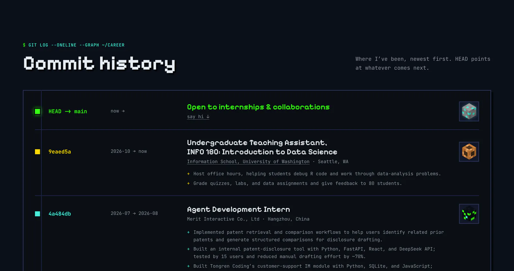
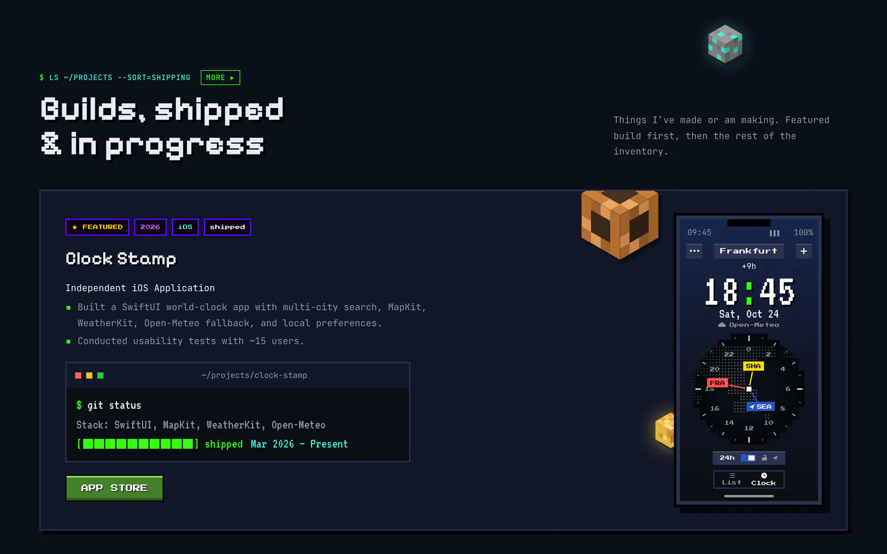
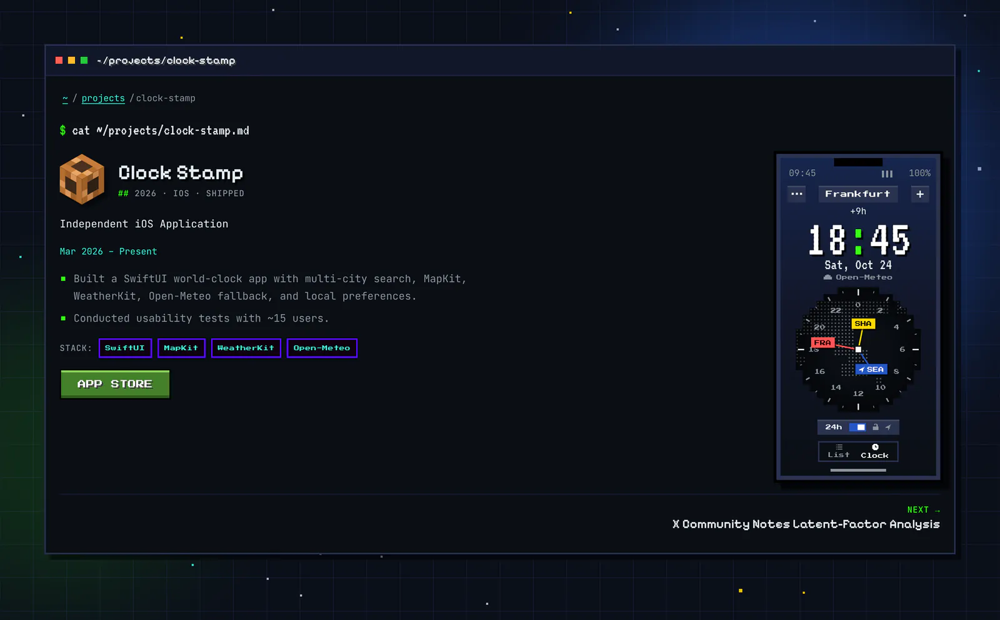
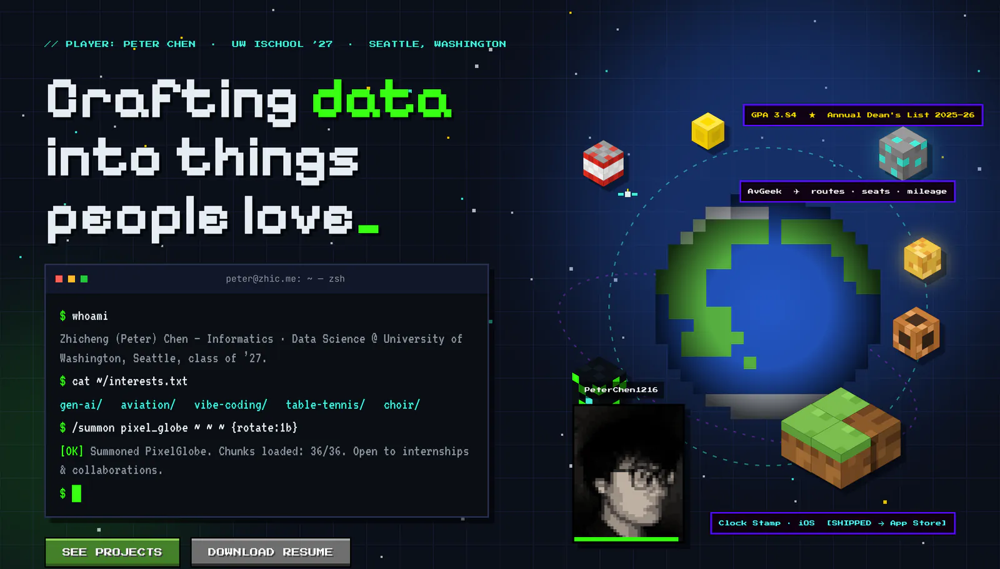
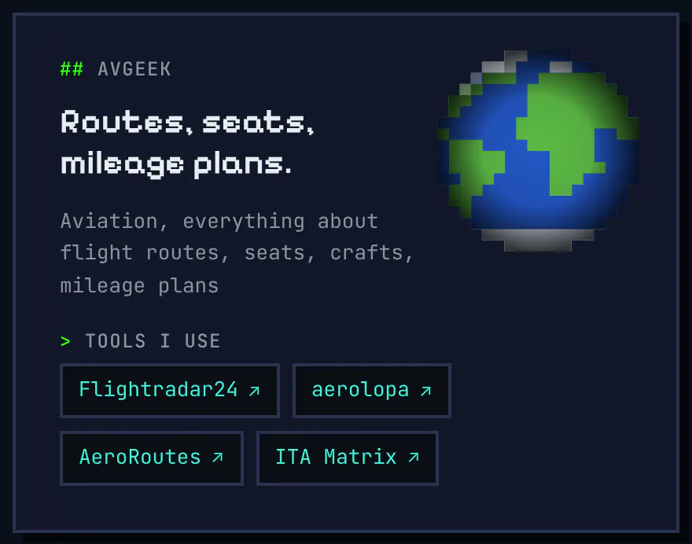

# 内容更新指南（CONTENT-GUIDE）

> 给 Peter：网站上的每一条信息都在 `content/` 里，改它们不用碰代码。这份指南按「要做的事」分节：改哪个文件、改前改后长什么样、运行什么、结果是什么样子。文件名、字段名和命令保持原样（英文），说明用中文。
> 例子里的公司、日期、链接都是 **明显的占位**（Your Company、2027-01、example.com），不是你的事实——照着格式换成你自己的。
> 截图来自当前的网站（Night 主题，1440 宽）。命令输出是在一份全新的克隆里照着本指南真实运行的结果；pnpm 在每条命令前会先打印两行（`> zhic-me@0.1.0 content:check /你的/Mysite`、`> node scripts/check-content.mjs`），失败时最后多一行 ` ELIFECYCLE  Command failed with exit code 1.`——下面第一个例子完整列出，之后省略。

## 目录
0. [每次都一样的三步，和三条路](#0-每次都一样的三步和三条路)
1. [文件地图：页面上的东西在哪个文件](#1-文件地图页面上的东西在哪个文件)
2. [YAML 和 Markdown 的五条规矩](#2-yaml-和-markdown-的五条规矩)
3. [加一段经历](#3-加一段经历)
4. [加或改一个项目（和它的页面）](#4-加或改一个项目和它的页面)
5. [换简历](#5-换简历)
6. [改状态行和「现在在做」](#6-改状态行和现在在做)
7. [加一条关注的航线](#7-加一条关注的航线)
8. [改界面文字](#8-改界面文字)
9. [翻译、审阅、让一种语言上线](#9-翻译审阅让一种语言上线)
10. [主题对你的内容做了什么](#10-主题对你的内容做了什么)
11. [CI 报错怎么读](#11-ci-报错怎么读)
12. [上线前先看效果](#12-上线前先看效果)
13. [自动的东西（不要手写）](#13-自动的东西不要手写)
14. [让 Claude 帮你改](#14-让-claude-帮你改)
15. [第一次在自己电脑上准备（一次性）](#15-第一次在自己电脑上准备一次性)
16. [五分钟清单](#16-五分钟清单)

---

## 0. 每次都一样的三步，和三条路

**三步**：① 改 `content/` 里的一个文件 → ② 检查（`pnpm content:check`，或交给 CI）→ ③ 提交。部署是自动的。

| 路 | 适合 | 你要做的 | 检查由谁做 |
|---|---|---|---|
| **A. GitHub 网页** | 改一两行字、换简历；不想装任何东西 | 在 github.com 打开文件 → 右上角铅笔 ✎ → 改 → **Commit changes…** | CI（推送后自动跑，见 §11） |
| **B. 自己电脑** | 加经历 / 项目这类多行改动；想先看效果 | `git pull` → 编辑 → `pnpm content:check` → `git commit` → `git push` | 你自己先跑一遍（1 秒），CI 再跑一遍 |
| **C. 让 Claude 改** | 懒得找文件；要翻译 | 用中文说要改什么（§14） | Claude 跑检查，你看改动后合并 |

**提交到哪里**：
- 直接提交到 `main`：约 11 分钟后上线（发布前要先跑完浏览器测试）。现在是预览地址 `https://zhic.me/v2/`，上线后是 `https://zhic.me/`。如果内容有错，**部署会在检查那一步停下，线上网站保持原样**，GitHub 会发邮件告诉你哪里错（§11）。
- 想先看效果再上线：网页上选 **Create a new branch for this commit and start a pull request**（本机就 `git switch -c 分支名`），CI 会为这个分支构建一份网站给你下载预览（§12），满意后在 pull request 页面 **Squash and merge**。

**提交说明**（commit message）写成 `content: 一句话`，例如 `content: add a job at Your Company`。CHANGELOG 是从这些说明自动生成的（§13）。网页编辑器默认的 `Update experience.yaml` 也可以——只改了 `content/` 的提交会自动归到「Content」。

---

## 1. 文件地图：页面上的东西在哪个文件

| 页面上 | 文件 | 字段 |
|---|---|---|
| 名字、一句话定位、所在城市、状态（"Open to internships…"）、邮箱、GitHub / LinkedIn、头像 | `content/profile.yaml` | `name`、`tagline`、`location`、`status`、`emails`、`socials`、`avatar` |
| About 段落 | `content/about.md` | 正文（Markdown） |
| 滚动条里的 `[NOW]` 条目 | `content/now.md` | 每行一个 `- ` |
| 教育、GPA、课程 | `content/education.yaml` | 每所学校一项 |
| 经历（git log 样式）与 Community（志愿） | `content/experience.yaml` | 每段经历一项；`kind: volunteer` 进 Community |
| 荣誉 | `content/honors.yaml` | 每项荣誉一项 |
| 兴趣（终端里的 `cat ~/interests.txt`、off the clock 卡片） | `content/interests.yaml` | `items` |
| 技能 | `content/skills.yaml` | `groups` |
| 项目卡片、项目详情页 `/projects/<名字>/`、项目目录 | `content/projects/<名字>.md` | 文件名 = 网址；字段见 §4 |
| AvGeek 控制台（航线、座位、新闻、票价代码、工具） | `content/aviation.yaml` | `watching`、`seat_rules`、`favorite_cabins`、`news`、`fare_examples`、`tools` |
| 简历 PDF | `content/resume/Resume.pdf` | 整个文件（§5） |
| 标题、按钮、提示等界面文字 | `content/copy.yaml`（中文：`copy.zh-hans.yaml`、`copy.zh-hant.yaml`） | §8 |
| 网站设置：域名、是否已上线、每种语言的状态、标题与描述、页脚说明 | `content/site.yaml` | `launched` 与 `locales` 只在决定上线时改 |
| 图片（头像、公司 logo、项目图标） | `content/images/` | 由上面的文件按路径引用 |
| 想交给 Claude 处理的素材 | `content/artifacts/` | 随便丢，见 §14 |

不在 `content/` 里的都是代码，不用碰。

---

## 2. YAML 和 Markdown 的五条规矩

1. **缩进只用空格**，同一层对齐。Tab 会报错：`a tab is used to indent this line — YAML needs spaces`。
2. **列表每项以 `- ` 开头**（减号 + 空格）。一项里的其他字段与第一个字段对齐。
3. **文字里有 `: `（冒号 + 空格）或 ` #` 时，整段用引号包起来**：`role: "Intern: Summer"`。否则 `#` 后面的字会被当成注释悄悄截掉——检查会拦下：`"the #1 seat" was cut off at "#" — wrap the whole value in quotes`。
4. **日期**：年月写 `YYYY-MM`（`2027-01`），还没结束写 `present`；新闻日期写 `YYYY-MM-DD`。
5. **`#` 开头的行是注释**，网站不显示，可以随便写给自己看。Markdown（`.md`）里给自己看的话用 `<!-- … -->`，**一定要用 `-->` 关上**，否则后面的内容会从页面上消失（检查会拦下）。

另外：只写 schema 认识的字段——拼错（`strat:`）会被拦下并提示正确的名字；招聘者可能核验的事实（经历、教育、荣誉、项目）都要写 `source:`（出处，一句话即可）。

---

## 3. 加一段经历

**文件**：`content/experience.yaml`。顺序随意，网站按日期排序（最新的在最上面）。

**改之前**（文件开头）：
```yaml
# One item per role, any order (the site sorts by date).
# kind: volunteer entries are shown under "Community" instead of "Experience".
- company: Information School, University of Washington
  role: "Undergraduate Teaching Assistant, INFO 180: Introduction to Data Science"
```

**改之后**——在第一项前面加一项（`- company:` 顶格减号，其余缩进两个空格）：
```yaml
# One item per role, any order (the site sorts by date).
# kind: volunteer entries are shown under "Community" instead of "Experience".
- company: Your Company
  role: Your Role
  kind: internship          # internship / full-time / part-time / research / volunteer
  start: 2027-01
  end: present              # 结束了就写 YYYY-MM
  location: Seattle, WA
  url: https://example.com/ # 可不写
  highlights:               # 1–5 条，每条一行
    - One line about what you did.
  source: offer letter, 2027-01   # 必填：这条事实从哪来

- company: Information School, University of Washington
  role: "Undergraduate Teaching Assistant, INFO 180: Introduction to Data Science"
```
可选：`logo: ./images/your-logo.webp` + `logo_alt: Your Company logo`（图片先放进 `content/images/`）。

**运行**（本机，路 B）：
```console
$ pnpm content:check

> zhic-me@0.1.0 content:check /Users/you/Mysite
> node scripts/check-content.mjs

✔ content: every file reads correctly; no placeholders
```

**结果**：Experience 的 git log 多一行，按开始日期排（最新的在最上面，紧挨着顶上的 `HEAD → main`——那一行是你的状态，见 §6）；日期栏显示 `2027-01 → now`。中文页面上这段先显示英文（读屏按英文读），要中文就加翻译块（§9）。



**常见错误和检查说的话**（把 `2027-01` 写成 `2027-1`）：
```console
$ pnpm content:check

> zhic-me@0.1.0 content:check /Users/you/Mysite
> node scripts/check-content.mjs

error: content/experience.yaml:6: item 1 (Your Company) → start: Use the YYYY-MM format, e.g. 2024-07 — you wrote "2027-1"
✖ content check failed: 1 problem(s) to fix. Each line above names the file and line; docs/CONTENT-GUIDE.md "CI 报错怎么读" explains every kind.
 ELIFECYCLE  Command failed with exit code 1.
```
冒号后面依次是：文件:行号、第几项（带公司名）、字段、规则、你写的值。改好再跑一次。

---

## 4. 加或改一个项目（和它的页面）

**文件**：`content/projects/<名字>.md`。**文件名就是网址**：`clock-stamp.md` → `/projects/clock-stamp/`。名字只用小写字母、数字和连字符。每个项目自动有：首页的卡片、自己的详情页、目录 `/projects/` 里的一行、分享图（OG 图）。

**新项目**——新建 `content/projects/your-project.md`（复制一个现有项目文件改最省事）：
```markdown
---
title: Your Project
tagline: One line in your own words   # 可不写；最多 120 字符
status: wip                           # idea / wip / testflight / shipped / completed / archived
platform: [web]                       # ios / web / cli / research，可多个
start: 2027-01
end: present                          # start 和 end 要么都写，要么都不写
links:
  repo: https://github.com/you/your-project
  live: https://example.com/
stack: [Python, SQLite]               # 最多 8 个
year: 2027
source: your own project
---

- What it does, one line.
- What you did, one line.
```
`---` 之间是字段，下面是正文（详情页上显示的要点）。

**改现有项目**：只改要改的那一行，例如 Clock Stamp 有了新版本：
```diff
-tagline: Independent iOS Application
+tagline: Your new one-line description
```

**其他字段**：`role`、`location`（研究 / 课程项目）；`links.appstore`；`links.other: [{ label: Lab page, url: https://example.com/ }]`；`icon: ../images/x.png`（路径从 `projects/` 文件夹算起）；`cover` + `cover_alt`；`featured: true`（大卡片，只有第一个 featured 的项目是大卡片）；`demo: world-clock`（只给 Clock Stamp 的手机画面用）。

**运行**：
```console
$ pnpm content:check
✔ content: every file reads correctly; no placeholders
```

**结果**：首页 Projects 多一张卡片（featured 的在前，其余按时间），点标题或 `more ▸` 在窗口里打开；`/projects/your-project/` 是它自己的页面。





**删掉一个项目**：删掉它的 `.md`，以及同名的 `*.zh-hans.md`、`*.zh-hant.md`（否则检查会说 `a translation of a file that does not exist`）。

---

## 5. 换简历

网站只发布一个文件：`content/resume/Resume.pdf`。替换它即可，版本号、发布路径、下载文件名全部自动（§13）。

**路 B（本机）**——一个命令：
```console
$ pnpm resume ~/Downloads/your-new-resume.pdf
```
它检查这是真的 PDF，把它放到 `content/resume/Resume.pdf`（如果它在 `content/artifacts/` 里，就移动过去），然后告诉你新版本和下一步：
```console
$ pnpm resume ~/Downloads/your-new-resume.pdf
✔ copied /Users/you/Downloads/your-new-resume.pdf → content/resume/Resume.pdf
  new résumé 2026-11-10-b39161e4 (153 KB, dated 2026-11-10: the day it last changed in Git, or today if it is not committed yet)
    published at /v2/resume.pdf (the address that never changes)
             and /v2/resume/2026-11-10-b39161e4.pdf (this version's own address)
  the download buttons save it as <your name>-Resume-2026-11-10.pdf
Everything in the PDF is public once it is on the site (phone number, addresses …).
Next: pnpm content:check, then commit content/resume/Resume.pdf, e.g.:
  git add content/resume/Resume.pdf && git commit -m "content: new résumé" && git push
```
不是 PDF 时它什么也不改：
```console
$ pnpm resume ~/Downloads/your-resume.docx
✖ /Users/you/Downloads/your-resume.docx: this is not a PDF (it looks like a Word or Pages file) — export the résumé as PDF first
```
不带文件运行 `pnpm resume`，显示现在发布的是哪一版：
```console
$ pnpm resume
résumé 2026-11-09-4975a202 (153 KB, dated 2026-11-09: the day it last changed in Git, or today if it is not committed yet)
  published at /v2/resume.pdf (the address that never changes)
           and /v2/resume/2026-11-09-4975a202.pdf (this version's own address)
```

**路 A（网页）**：先在自己电脑上把新 PDF **改名为 `Resume.pdf`**（大小写一致）→ 在 GitHub 打开 `content/resume/` → **Add file → Upload files** → 拖进去 → Commit。名字不对时 GitHub 会多出一个文件，检查会拦下：
```console
error: content/resume/resume-new.pdf: the site only publishes content/resume/Resume.pdf — if this is your new résumé, rename it to Resume.pdf (replacing the old one); otherwise delete it
```
不是 PDF（例如传了 .docx）也会被拦下：`this is not a PDF (it looks like a Word or Pages file) — export the résumé as PDF and replace this file`。

**结果**：首页与 Contact 的下载按钮（还有导航里的 RESUME）拿到新文件，下载下来叫 `Peter-Chen-Resume-<日期>.pdf`。**PDF 里的所有内容都会公开**（电话号码、地址……），上传前看一眼。



---

## 6. 改状态行和「现在在做」

**状态行**：`content/profile.yaml` 的 `status`，显示在英雄区终端（`/summon` 的回答，见 §5 的截图）和 Experience 顶上的 `HEAD → main` 那一行。
```diff
-status: Open to internships & collaborations
+status: Your new one-line status
```
改了英文之后，两种中文的 `status` 译文就「过期」了（§9）——`pnpm content:stale` 会列出来；中文页面继续显示旧译文，直到你更新：
```console
$ pnpm content:stale
Translations to look at (a report — it does not fail the build):
zh-hans (preview): 1 to look at
  content/profile.yaml: status — its source changed — once it matches, set `from: { status: "fcaf5428" }`
zh-hant (preview): 1 to look at
  content/profile.yaml: status — the Simplified text it comes from is out of date with English
```


**「现在在做」**：`content/now.md`，每行一个要点，出现在英雄区下面的滚动条里，标 `[NOW]`。现在这个文件是空的（只有一行注释），所以滚动条里没有 `[NOW]`。
```markdown
<!-- What you're doing right now, one short line per bullet. … -->
- Your current focus, one short line
- Another one
```
链接和 **加粗** 在滚动条里显示成纯文字。清空（只留注释）就不显示。

![英雄区下面的滚动条：现在没有 [NOW] 条目](content-guide/ticker.webp)

About 的「now building」卡片不在这里改：它显示 `end: present` 的项目（featured 优先），见 §4。


---

## 7. 加一条关注的航线

**文件**：`content/aviation.yaml` 的 `watching`（最多 6 条）。现在是空的，所以 AvGeek 卡片只显示工具栏，地球上没有航线。

**改之前**：
```yaml
watching: []
```
**改之后**：
```yaml
watching:
  - from: SEA            # IATA 机场代码，三个大写字母
    to: NRT
    airline: Your Airline
    aircraft: "787-9"    # 有横线、或像数字的，用引号
    why: One line on why you are watching it.
```
其他面板同理：`seat_rules`（每行一条规则）、`favorite_cabins`（`aircraft`、`cabin`、`why`）、`news`（`date: 2027-01-15`、`headline`、`url`，最多 5 条）、`fare_examples`（`code`、`route`、`notes`）。空列表的面板自动隐藏。

**运行**：`pnpm content:check`。如果场景（WebGL 地球）不认识某个机场，会给一条提示（不是错误，结尾仍是 ✔）：航线照样出现在卡片上，只是地球上不画——告诉 Claude 加上这个机场即可。
```console
$ pnpm content:check
warning: content/aviation.yaml watching SEA → XYZ: the scene has no position for "XYZ" — the route shows on the AvGeek card but not on the globe (add it to src/scene/airports.ts)
✔ content: every file reads correctly; no placeholders
```

**结果**：AvGeek 卡片列出航线；英雄区的 AvGeek 徽章显示第一条航线的机场；桌面 3 级图形时 WebGL 地球上画出大圆弧和飞机。



---

## 8. 改界面文字

**文件**：`content/copy.yaml`——标题、按钮、提示、终端命令行的文字。这里没有关于你的事实，可以随便改措辞。
```diff
 hero:
-  cta_projects: SEE PROJECTS
+  cta_projects: SEE MY WORK
```
规则：
- `{占位符}` 由内容自动填入：`{first}`（名）、`{host}`（名的小写）、`{city}`、`{email}`、`{domain}`、`{major}`、`{department}`、`{school}`、`{short}`；个别行还有自己的（文件里的注释写着）。写错名字（`{emial}`）构建会失败并指出哪一行。
- `headline` 里 `[方括号]` 是绿色高亮的词。
- **手机上才看得到的几行**（X4，窄于 768 px 的屏幕）：`nav.hotbar`（底部热键栏四个栏目的短名，顺序与 `nav.links` 相同，个数也必须相同）和 `nav.hotbar_prefs`（⚙ 那一格）；`hero.more` / `hero.less`（折起来的终端的「更多 ▾ / 收起 ▴」键）；`hero.badges_label`（地球下面那排可以横滑的徽章，读屏软件念的名字）；`projects.list_all`（项目轮播下面的「全部列出 ▸」）和 `projects.position`（读屏软件念的「第几张，共几张」，`{n}`、`{count}` 自动填入）。在桌面上改了看不出变化，用 `pnpm dev` 打开后把浏览器窗口拉窄（或开发者工具的手机模式）看。
- **只改值，不要增删键**：两个中文文件必须有和 `copy.yaml` 完全一样的键，少一个或多一个都会被拦下。

**运行**：`pnpm content:check`（结尾 ✔），然后 `pnpm content:stale`，它列出因此过期的中文译文（只是提醒，不会失败）——更新中文的方法见 §9：
```console
$ pnpm content:stale
Translations to look at (a report — it does not fail the build):
zh-hans (preview): 1 to look at
  content/copy.zh-hans.yaml: hero.cta_projects — its source changed — once it matches, set `from: { hero.cta_projects: "9a532043" }`
zh-hant (preview): 1 to look at
  content/copy.zh-hant.yaml: hero.cta_projects — the Simplified text it comes from is out of date with English
```

---

## 9. 翻译、审阅、让一种语言上线

网站有三种语言：`/`（英文，源头）、`/zh-hans/`（简体）、`/zh-hant/`（繁体，香港字形与用词）。两种中文现在是 **preview（预览）**：照常发布在它们的网址上给你读，但搜索引擎不收录、语言切换里看不到，每页顶上写着「草稿译文，尚未经过审阅」。


**译文放在哪里**
- 界面文字：`copy.zh-hans.yaml`、`copy.zh-hant.yaml`，键和 `copy.yaml` 一模一样。终端命令、ping 输出、Clock Stamp 手机画面保持英文。
- 有语言的事实（职位、要点、地点、课程、兴趣…）：在英文旁边加 `zh-hans:` / `zh-hant:` 块，只写要翻译的字段：
  ```yaml
  - company: Your Company          # 公司、学校、产品名、日期、网址、GPA：只写一份，不翻译
    role: Your Role
    zh-hans:
      role: 你的职位
      from: { role: "1a2b3c4d" }   # 译自哪段英文：由 pnpm content:stale 写
  ```
  没写的字段显示英文（标 `lang="en"`，读屏按英文读）。
- Markdown：旁边放同名翻译文件——`about.zh-hans.md`、`projects/your-project.zh-hant.md`（正文是译文；frontmatter 里可以翻译 `title`、`tagline`、`role`、`location`）。

**草稿：`draft: true`**——「还没人读过」。Claude 起草的简体、脚本转换的繁体都带它。可以写在块里、文件开头、翻译文件的 frontmatter 里，也可以只列字段：`draft: [role, highlights]`。

**审阅一段译文**：读、改，然后删掉它的 `draft: true`（或从 `draft: [...]` 里删掉那个字段）。

**让一种语言上线**：
1. 读它的全部译文并修改；
2. 删掉它所有的 `draft`；
3. `content/site.yaml` 里把它从 `preview` 改成 `live`：
   ```diff
    locales:
      en: live
   -  zh-hans: preview
   +  zh-hans: live
   ```
4. `pnpm content:check`。还有草稿时，它按文件告诉你还剩多少（真实输出：现在就把简体改成 live，会得到 11 行这样的错误，这里列 3 行）：
   ```console
   error: content/profile.yaml: 4 zh-hans translation(s) still marked draft (tagline; location; status; and 1 more), but zh-hans is live in content/site.yaml — read them and delete their "draft", or set zh-hans back to preview
   error: content/honors.yaml: 3 zh-hans translation(s) still marked draft (#1 (Annual Dean's List) › name; #2 (Annual Dean's List) › name; #2 (Annual Dean's List) › note), but zh-hans is live in content/site.yaml — read them and delete their "draft", or set zh-hans back to preview
   error: content/copy.zh-hans.yaml: 230 zh-hans translation(s) still marked draft (nav.links; nav.status; nav.resume; and 227 more), but zh-hans is live in content/site.yaml — read them and delete their "draft", or set zh-hans back to preview
   ✖ content check failed: 11 problem(s) to fix. …
   ```
   （`#1 (Annual Dean's List) › name` = 第 1 项、它的 `name` 字段。`copy.zh-hans.yaml` 开头那一行 `draft: true` 一次标了整个文件。）
   **live 的语言里有任何 `draft`，检查和构建都会失败**——所以带草稿的改动合并到 main 也不会让未读的译文当成定稿上线。

**繁体从简体生成**：`pnpm content:hant` 把「简体有、繁体没有」的字段转成香港繁体字形（OpenCC `s2hk`：裏、着、綫、衞），写成 `draft: true`。只转字形、不改用词；**已经存在的繁体字段永远不会被覆盖**。它会列出一对多、需要人看的字（发 → 發 / 髮，后 → 後 / 后，干 → 乾 / 幹 / 干，面 → 麵 / 面，并 → 並 / 併 …）。审繁体时把用词换成香港的：

| 简体 / 内地 | 香港 |
|---|---|
| 信息 | 資訊 |
| 设置 | 設定 |
| 默认 | 預設 |
| 链接 | 連結 |
| 联系 | 聯絡 |
| 加载 | 載入 |
| 源代码 | 原始碼 |
| 反馈 | 回饋 |
| 视频 | 影片 |
| 博客 | 網誌 |

默认用书面语（不是口语粤文）。语言自己的名字（`i18n.name`、`i18n.suggest`、`i18n.suggest_go`）不转换，要手写（检查会拦下两种语言同名）。

**过期提醒：`pnpm content:stale`**——英文改了，两种中文都列出（繁体写「经由简体」）；简体改了，繁体列出。只是提醒，CI 里每次都跑，从不失败；过期的译文照常显示，直到你更新。更新译文后运行 `pnpm content:stale --accept zh-hans`（或 `zh-hant`，后面可跟文件名）记下当前来源。

---

## 10. 主题对你的内容做了什么

网站有五个主题（Night、Day、Mono dark、Mono light、色盲友好），访客在设置里选。**主题只换颜色，不换内容**：每个主题显示同样的文字、链接、日期——你不需要为主题写任何东西。

你需要知道的只有图片：
- **Night、Day、色盲友好**：头像、logo、项目图标按原样显示。
- **Mono dark / Mono light**：这些图片显示成灰度。加新 logo 时，到设置里切到 Mono light 看一眼——只有浅色线条的 logo 在白底上可能看不清。
- 状态、分类不只靠颜色区分（还有符号和文字），所以内容里不要写「绿色的那个」这类只靠颜色的说法。

英雄区的玩家卡（你的头像）在五个主题里，从左到右：Night、Day、Mono dark、Mono light、色盲友好——头像在两个 Mono 主题里是灰度，名字牌和 XP 条换成各主题的颜色：


---

## 11. CI 报错怎么读

每次推送，GitHub Actions 运行 **CI**（`.github/workflows/ci.yml`）；推送到 `main` 时还运行 **Deploy**（`deploy.yml`）。它们在提交旁边显示 ✓ 或 ✗，失败时 GitHub 给你发邮件。

**在哪里看**：提交旁的 ✗ → **Details**；或仓库的 **Actions** 页 → 点那次运行。运行页顶上的 **Annotations** 框直接列出每个内容问题（「Content check」，带文件和行号）；在 pull request 的 **Files changed** 里，问题显示在对应那一行旁边。想看全文：点左边的作业 → 展开 **Content guard** 这一步。

**CI 的步骤**（按顺序；前一步失败，后面的不跑）：

| 步骤 | 查什么 | 你会遇到吗 |
|---|---|---|
| Format · Lint · Colour tokens · Type check | 代码 | 只改 `content/` 时不会 |
| **Content guard** | `pnpm content:check`：每个文件的字段、YAML 写法、占位、简历、译文草稿 | **会**——内容错误几乎都在这一步 |
| Translation staleness report | `pnpm content:stale`：过期的译文 | 只是报告，从不失败 |
| Unit tests · CHANGELOG | 代码与脚本 | 不会 |
| **Build** | 用同样的规则再读一遍内容并生成网站；`{占位符}` 写错在这里失败 | 偶尔 |
| Size budgets · Assemble · E2E（浏览器测试） | 体积与页面行为 | 内容极长时可能 |

Deploy 先跑 `pnpm content:check --strict`，再构建、测试、发布；**任何一步失败都不会发布，线上网站保持上一次的样子**。

**一条报错的结构**：
```text
error: content/experience.yaml:7: item 1 (Your Company) → start: Use the YYYY-MM format, e.g. 2024-07 — you wrote "2027-1"
       └ 文件:行号 ──────────┘  └ 第几项（名字）┘ └ 字段 ┘ └ 规则 / 该怎么写 ──────────┘ └ 你写的 ─────┘
```
`error` 必须改；`warning` 是提示（不会失败）。最后一行 `✖ content check failed: N problem(s)` 是总数。

**各种报错和怎么改**（都摘自真实运行的输出，`…` 处是省略）：

| 你看到 | 意思 | 怎么改 |
|---|---|---|
| `… → start: Use the YYYY-MM format, e.g. 2024-07 — you wrote "2027-1"` | 日期格式 | 写成 `2027-01` |
| `… "strat" is not a field here — did you mean "start"? (fields here: …)` | 字段名拼错，或放错了层级 | 按提示改名；括号里是这里允许的字段 |
| `… → end: this field is missing. Use the YYYY-MM format (e.g. 2024-07), or present if it is still going on` | 必填字段漏了 | 加上这一行 |
| `… → status: this is empty — write the value after the colon, or delete the line` | 冒号后面什么也没写 | 写上，或删掉这行（可选字段） |
| `… → status: use one of: idea, wip, testflight, shipped, completed, archived — you wrote "done"` | 只能从几个词里选 | 换成其中一个 |
| `… → year: should be a number such as 2026 (without quotes) — you wrote "this year"` | 要数字 | 写数字，不加引号 |
| `… → tagline: should be text, not 2026 — if 2026 is what you mean, put it in quotes: "2026"` | 要文字，YAML 把它读成了数字 | 加引号 |
| `… → highlights: has 6 items; at most 5 are allowed — remove 1` | 太多 | 删到上限 |
| `… → tagline: is 136 characters long; at most 120 — shorten it` | 太长 | 缩短 |
| `… → address: should be an email address, e.g. name@example.com` / `… → url: should be a full web address starting with https://` | 邮箱 / 网址格式 | 写完整 |
| `… → logo: There is no image at ./images/x.png — put the file there, or fix the path` | 图片路径不对 | 把图片放进 `content/images/`，或改路径 |
| `this YAML cannot be read: text that contains ": " (a colon and a space) must be wrapped in quotes` | 文字里有 `: ` | 整段加引号（§2 第 3 条） |
| `this YAML cannot be read: a tab is used to indent this line — YAML needs spaces` | 用了 Tab | 换成空格 |
| `this YAML cannot be read: the same field is written twice here — keep one` | 同一项里一个字段写了两次 | 删掉一个 |
| `"… #…" was cut off at "#" — wrap the whole value in quotes` | ` #` 把后半句变成了注释 | 加引号 |
| `"TODO" marks unfinished text — write the real text or delete the line (allowed on a branch, never on main)` | 占位（`TODO` / `lorem` / `placeholder`） | 在分支上是 warning；到 main 或指向 main 的 pull request 上是 error |
| `"<!--" is never closed with "-->"` | Markdown 注释没关 | 在注释结尾加 `-->` |
| `content/projects/My Project.md: only project files go here, named with lowercase letters…` | 项目文件名不合规 | 改名为 `my-project.md` |
| `content/resume/…: the site only publishes content/resume/Resume.pdf …` / `this is not a PDF` | 简历名字或格式 | §5 |
| `N zh-hans translation(s) still marked draft (…), but zh-hans is live` | 上线的语言里还有草稿 | 审完删 `draft`，或改回 preview（§9） |
| `content/copy.zh-hans.yaml: missing hero.x — copy.yaml has these lines and this file must too` | 中文界面文件少了键 | 加上并翻译（§8 只改值就不会遇到） |
| `warning: content/experience.yml: the site does not read this file — did you mean experience.yaml?` | 网站不读这个文件 | 改名或删除 |
| `warning: content/artifacts/: 1 file(s) not on the site yet (…)` | 素材还在投放文件夹里 | 让 Claude 处理（§14），或自己按 §4 / §5 放好 |

YAML 写坏时只报**第一处**（后面的通常是它的连锁反应）：改好再跑一次。

**Build 一步的报错**（极少）：`content:check` 不检查 `{占位符}` 的名字，写错时构建失败，例如（真实输出）：
```text
copy.yaml contact.ping.request: unknown or empty placeholder {emial} in "PING {host} ({emial}): 56 data bytes"
```
即 `copy.yaml` 的 `contact → ping → request` 这一行里 `{emial}` 不认识；改成 §8 列出的名字（`{email}`）。本机用 `pnpm build` 能复现（约 20 秒）。

---

## 12. 上线前先看效果

**a. 自己电脑，边改边看（最快）**：
```console
$ pnpm dev
…
 astro  v7.4.7 ready in 1708 ms
┃ Local    http://localhost:4321/v2/
┃ Network  use --host to expose
```
打开它打印的 **Local** 地址（上线后没有 `/v2/`；4321 被占用时它会换一个端口，并先打印 `Port 4321 is in use, trying another one...`）。保存文件后页面自动刷新（演练里不到 1 秒）；中文页面在 `/v2/zh-hans/`、`/v2/zh-hant/`，新项目的页面在 `/v2/projects/<名字>/`。`Ctrl+C` 停止。（开发模式不做中文字体子集化，字形与正式网站相同、只是加载慢一点。）

**b. 分支 / pull request 的预览（不用本机构建）**：GitHub Pages 一个仓库只有一个网站，所以分支没有自己的网址；CI 为每次推送构建整个网站，作为下载提供：
1. 打开这次 CI 运行的页面（提交旁的 ✓ / ✗ → Details → 左上 **Summary**）；
2. 「Preview this commit's site」下点 **site-<提交号>** 下载（zip，保留 7 天，需要登录 GitHub）；
3. 双击解压；
4. 在仓库里运行 `pnpm preview:site ~/Downloads/site-<提交号>`，打开它打印的地址：
   ```console
   $ pnpm preview:site ~/Downloads/site-0123abc
   serving /Users/you/Downloads/site-0123abc on http://localhost:4322
   open http://localhost:4322/v2/ — Ctrl+C stops it
   ```
   预览在 CI 开始后一两分钟就能下载（它在漫长的浏览器测试之前上传；整个 CI 约 20 分钟）。

**c. 什么时候是公开的**：`content/site.yaml` 的 `launched: false` 期间，`main` 发布到 `https://zhic.me/v2/`（不被搜索引擎收录，但知道地址的人能看到），旧站仍在 `https://zhic.me/`。改成 `true` 是上线决定，不是日常更新。两种中文在 preview 状态时同理（§9）。

---

## 13. 自动的东西（不要手写）

| 什么 | 从哪里来 | 在哪里看 |
|---|---|---|
| 页脚「updated 日期」 | 最后一次改动 `content/` 的提交日期（`content/README.md` 和 `content/artifacts/` 不算：它们不上页面） | 页脚 |
| 版本号 `v0.1.0+20261110.abc1234` | `site.yaml` 的 `version`（只在结构性变化时手动改）+ 那次提交的日期和编号 | 页脚 |
| `CHANGELOG.md` | 每次部署后由 `pnpm changelog` 从提交说明生成并提交（机器人 `github-actions[bot]` 的提交，`chore(changelog): …`）。一个合并进来的 PR 是一条：squash 合并时用那个提交的说明，普通合并（Merge pull request）时用 PR 的标题——所以 PR 标题也照提交说明的写法写 | 仓库根目录 |
| 简历的版本地址与下载文件名 | `Resume.pdf` 的内容与它最后一次被提交的日期 | `/resume/<日期>-<编号>.pdf`；下载名 `Peter-Chen-Resume-<日期>.pdf` |
| 分享图（OG 图） | 每页的标题与内容，构建时生成 | 在社交媒体贴链接时 |
| 繁体草稿、译文来源记录 | `pnpm content:hant`、`pnpm content:stale --accept` | 内容文件里 |


注意：因为 CHANGELOG 由机器人提交到 `main`，**本机工作前先 `git pull`**；`git push` 被拒（`rejected … fetch first`）时运行 `git pull --rebase`，再 `git push`。

---

## 14. 让 Claude 帮你改

在 Claude Code 里用中文直接说，例如「在经历里加一条：……（公司、职位、起止、地点、要点、出处）」「把 artifacts 里的新简历换上」「把 about 的简体译文审一遍，标出我要决定的地方」。仓库根目录的 `CLAUDE.md` 约束它：
- 只改 `content/`（除非你明确要求别的）；
- **不编造任何事实**——缺什么会问你；
- 不动 `launched` 和语言的 live / preview；
- 起草的译文一律 `draft: true`，由你审；
- 改完跑 `pnpm content:check`，在分支上提交，由你合并。

`content/artifacts/` 是投放文件夹：新简历、截图、logo 随便丢进去（文件名随意），让 Claude 放到正确的位置。

---

## 15. 第一次在自己电脑上准备（一次性）

需要：Git、Node 22.23 或更新（`node --version`）、pnpm 10（Node 22 自带的 corepack 提供；`corepack enable` 提示没有权限时，改用 `npm install -g pnpm@10`）。
```console
$ git clone https://github.com/PeterChen1216/Mysite.git
$ cd Mysite
$ corepack enable
$ pnpm install
```
第一次运行 `pnpm` 时 corepack 会先下载 pnpm 本身（`! Corepack is about to download https://registry.npmjs.org/pnpm/-/pnpm-10.28.0.tgz`），问你是否继续时回答 `Y`。`pnpm install` 第一次要下载依赖（`node_modules` 约 500 MB），之后几秒。
之后每次：`git pull` → 改 → `pnpm content:check` → `git add content/…` → `git commit -m "content: …"` → `git push`。

---

## 16. 五分钟清单

- [ ] `git pull`（本机）或在 GitHub 打开文件（网页）
- [ ] 按 §1 找到文件，按对应小节改
- [ ] `pnpm content:check` 结尾是 `✔`（网页路：提交后看 CI 的 ✓）
- [ ] 想先看：`pnpm dev` → http://localhost:4321/v2/（或 §12 的预览下载）
- [ ] 提交说明 `content: …`；推送 / 合并
- [ ] 几分钟后在网站上看到改动（Deploy 的 ✓）
